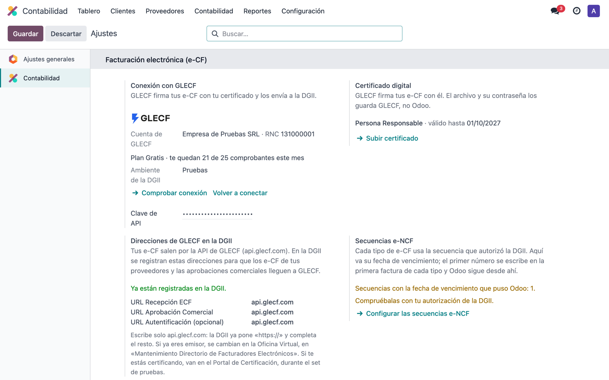
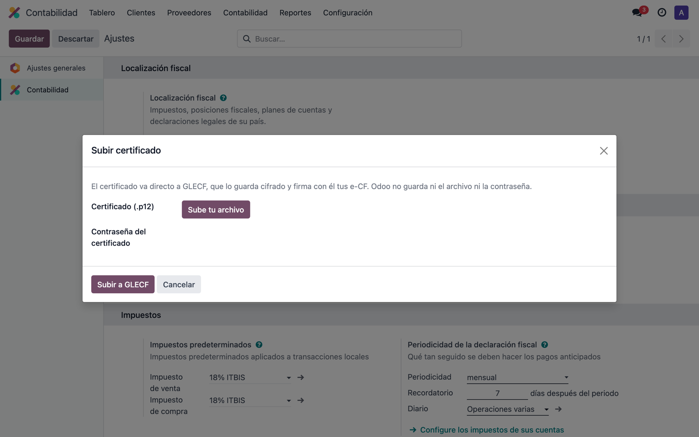
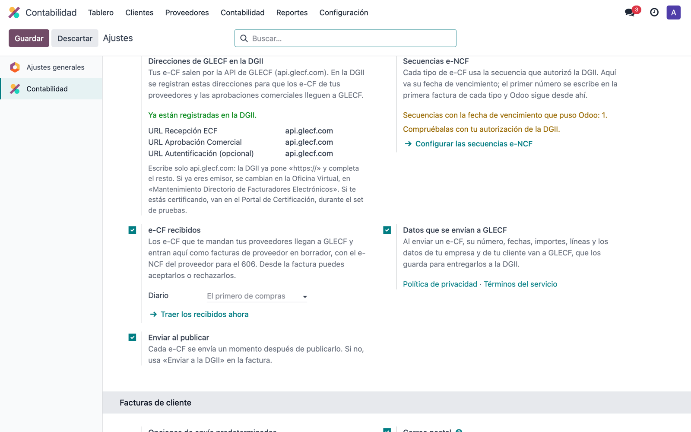
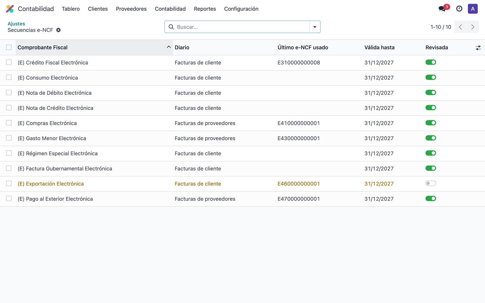
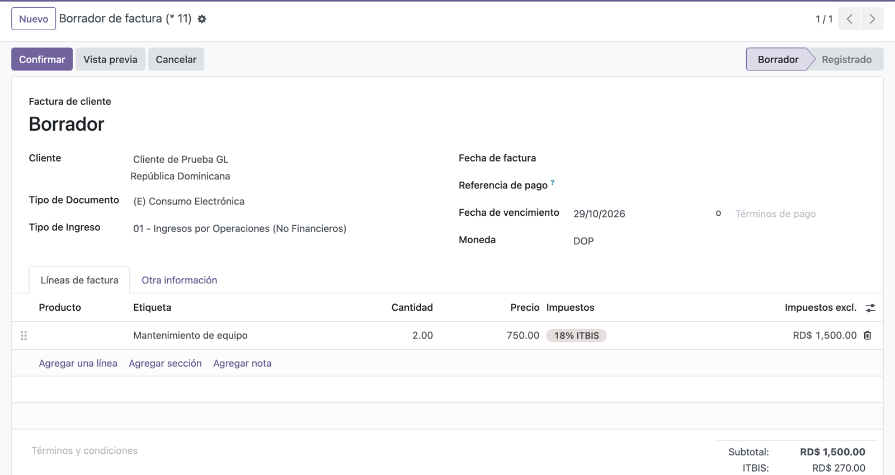
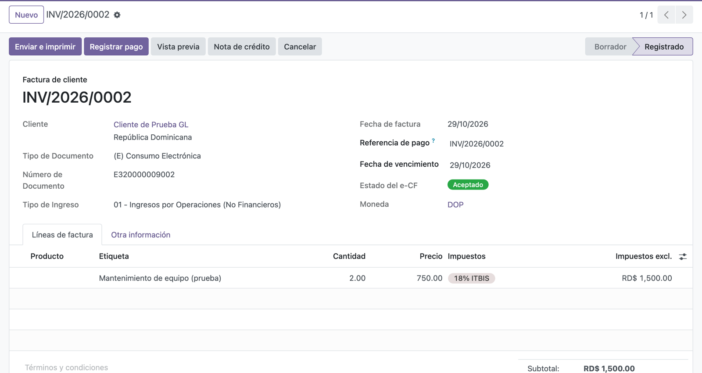
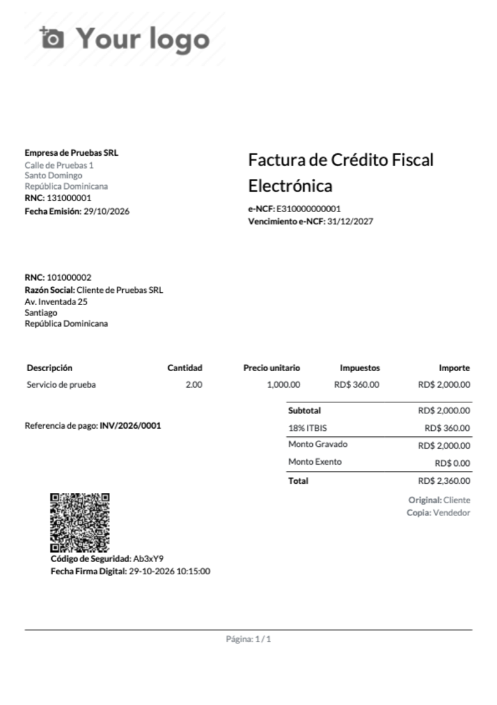
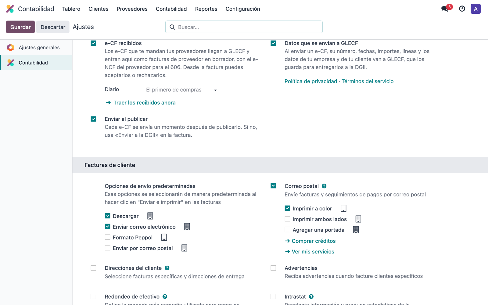
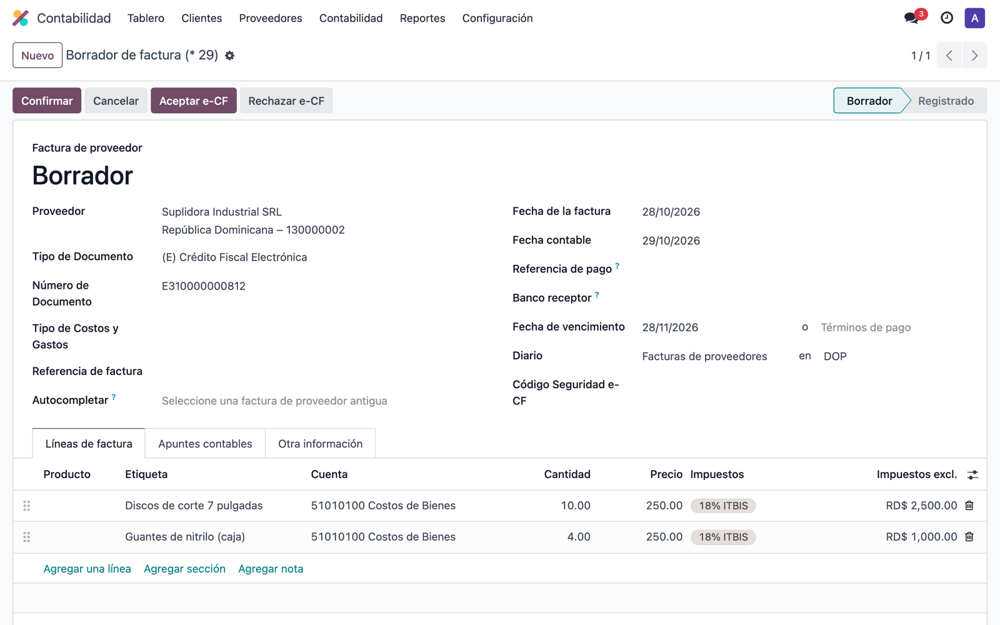
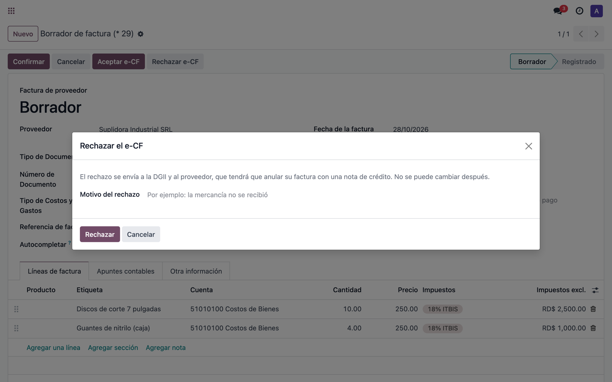

# Manual de e-CF DGII para Odoo

Facturación electrónica para Odoo en República Dominicana: tus facturas salen a
la DGII como comprobantes fiscales electrónicos (e-CF), según la Ley núm. 32-23
de Facturación Electrónica y el Decreto 587-24. La firma y el envío los hace
[GLECF](https://glecf.com).

> **El módulo está en mejora continua.** Funciona en Odoo 18 Community y
> Enterprise. Las capturas son de una empresa de pruebas.

## Antes de empezar

- Odoo 18. La localización dominicana viene incluida.
- Una cuenta de GLECF con **plan de pago** (Licencia Anual o plan a medida). El
  Plan Gratis no incluye Odoo: [glecf.com/precios](https://glecf.com/precios/).
- El certificado digital de la empresa (.p12).
- Odoo.sh o servidor propio. Odoo Online no admite módulos externos.

## 1. Conectar con GLECF

En *Ajustes → Contabilidad → Facturación electrónica (e-CF)*, pulsa
**Conectar con GLECF**, inicia sesión en GLECF y pulsa **Autorizar**. Vuelves a
Odoo conectado. No hay que copiar ninguna clave.

Ajustes te dice:

- la cuenta de GLECF y su RNC (tiene que ser el de tu empresa en Odoo);
- tu plan y cuántos comprobantes te quedan este mes;
- el ambiente de la DGII (Pruebas, Certificación o Producción);
- si la DGII ya te tiene como emisor electrónico. Si todavía no, solo puedes
  trabajar en Pruebas y el botón **Empezar la certificación** te lleva a GLECF.

Solo cuentan para el plan los comprobantes de Producción.

**Pasar a Producción.** El ambiente va con la conexión. Cuando la DGII ya te
tiene como emisor, debajo del ambiente sale **Cambiar a Producción**: vuelves a
GLECF y eliges «Producción» al autorizar.

¿Aún no tienes cuenta? **Crear una cuenta gratis en GLECF** abre el registro
con los datos de tu empresa ya puestos. Después contrata la Licencia Anual: el
Plan Gratis no incluye Odoo.

## 2. Subir el certificado

Pulsa **Subir certificado**, elige el archivo .p12 y escribe su contraseña. Va
directo a GLECF, cifrado. Odoo no guarda ni el archivo ni la contraseña.

## 3. Las direcciones para la DGII

Tus e-CF salen por la API de GLECF. Para que los comprobantes de tus
proveedores lleguen a GLECF, en la DGII se registran estas direcciones. En cada
caja se escribe solo `api.glecf.com`.

Si ya eres emisor, se cambian en la Oficina Virtual, en *Mantenimiento
Directorio de Facturadores Electrónicos*. Si te estás certificando, van en el
Portal de Certificación.

## 4. Las secuencias e-NCF

**Configurar las secuencias e-NCF** abre una lista con todos los tipos. Pon a
cada uno la fecha de vencimiento que autorizó la DGII. En amarillo, las que aún
tienen la fecha que puso Odoo.

El primer número de cada tipo se escribe en su primera factura. Después Odoo
sigue solo.

## 5. Facturar

Antes de la primera factura, marca **Datos que se envían a GLECF** en Ajustes.

1. En *Facturación > Clientes > Facturas*, pulsa **Nuevo** y elige el cliente.
   Odoo propone el tipo: **Crédito Fiscal** si el cliente tiene RNC, **Consumo**
   si no.
2. La primera factura de cada tipo pide el **Número de Documento** (el primer
   e-NCF, por ejemplo E310000000001). Después Odoo sigue solo.
3. Añade las líneas con su **ITBIS** y pulsa **Confirmar**.

En unos segundos sale a la DGII y la respuesta vuelve a la factura. El estado
cambia solo en la pantalla, sin recargar.

| Estado | Qué significa |
|---|---|
| Por enviar | Sale sola en unos segundos. Si **Enviar al publicar** está desactivado en Ajustes, pulsa **Enviar a la DGII** |
| Esperando a la DGII | Enviado; falta la respuesta |
| Aceptado | Listo |
| Aceptado con observaciones | Válido; lee el mensaje |
| Rechazado | Si sale **Corregir la factura**, púlsalo, corrige y confírmala otra vez: va con el mismo e-NCF. Si no, el número ya se usó: cancélala y créala de nuevo |
| No enviado | Falta un dato: el mensaje dice cuál. Si es de la factura, pulsa **Corregir la factura**, corrígela y confírmala otra vez. Si es de Ajustes, arréglalo y pulsa **Enviar a la DGII** |
| Requiere revisión | Lee el mensaje. Si sale **Reintentar envío**, no llegó a la DGII: arregla lo que dice y púlsalo. Si no, escribe a soporte@glecf.com |

Si la DGII dice que el certificado **no está delegado**, el administrador de
e-CF de la empresa tiene que darle el rol de Firmante a la persona del
certificado, en la Oficina Virtual (Delegación de e-CF > Delegación de Roles).

**Notas de crédito.** Desde la factura, pulsa **Nota de crédito**, escribe el
motivo y elige el **Código Modificación e-CF**. Si eliges *Porcentaje* o
*Importe*, Odoo crea una línea **sin ITBIS**: un aviso lo dice, y el botón
**Añadir el ITBIS de la factura original** lo pone antes de confirmar.

**En el ambiente de Pruebas** la DGII da a todas las secuencias el vencimiento
31-12-2028; el módulo lo pone solo.

Los diez tipos: E31, E32, E33, E34, E44, E45 y E46 desde las facturas de
cliente; E41, E43 y E47 desde las facturas de proveedor.

## 6. La factura impresa

Lleva el código QR de consulta de la DGII, el código de seguridad y la fecha y
hora de la firma, como pide la DGII.

**Si el PDF sale sin QR, sin logo o sin diseño**, Odoo no llega a su propia
dirección al generarlo. Pasa sobre todo con Docker o detrás de un proxy. Activa el
modo de desarrollador, ve a Ajustes > Técnico > Parámetros del sistema y crea
`report.url` con `http://localhost:8069`. Si tu Odoo usa otro puerto, pon ese.

## 7. Los e-CF que recibes

Los comprobantes que te mandan tus proveedores llegan a GLECF y entran en Odoo
como **facturas de proveedor en borrador**, con el e-NCF del proveedor listo
para el 606 y el XML adjunto. Las notas de crédito y débito se enlazan a su
factura.

En la factura:

1. Elige el **Tipo de Costos y Gastos** (lo pide el 606).
2. Pulsa **Aceptar e-CF**, o **Rechazar e-CF** con el motivo.
3. La respuesta va a la DGII y al proveedor. No se puede cambiar después.

Un e-CF rechazado no se puede publicar. La aprobación es opcional: si no la
envías, la DGII lo da por aceptado cuando lo declaras en el 606.

## Actualizar el módulo

Tu copia del módulo no se actualiza sola. Cuando hay una versión nueva, en Ajustes
> Facturación aparece el aviso «Hay una versión nueva del módulo». Para actualizar,
quien administra tu servidor:

1. Descarga la versión nueva, con `git pull` en la carpeta del módulo.
2. Reinicia Odoo.
3. En Aplicaciones, busca «e-CF DGII para Odoo» y pulsa **Actualizar**.

Tus facturas y ajustes se conservan.

## Ayuda

Escribe a soporte@glecf.com.
