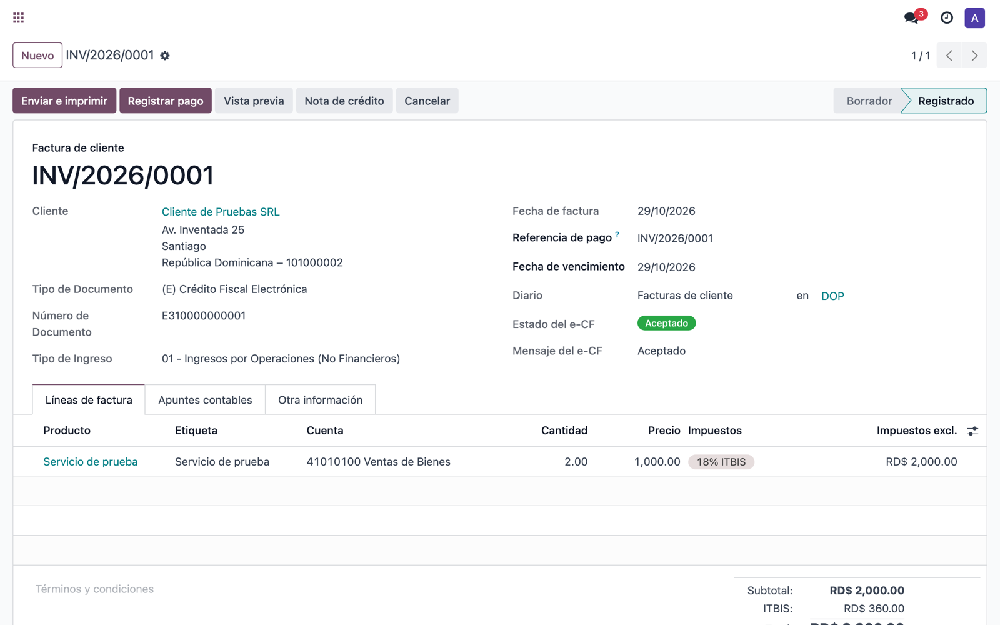

# Manual de e-CF DGII para Odoo

Facturación electrónica para Odoo en República Dominicana: tus facturas salen a
la DGII como comprobantes fiscales electrónicos (e-CF), según la Ley núm. 32-23
de Facturación Electrónica y el Decreto 587-24. La firma y el envío los hace
[GLECF](https://glecf.com).

> **El módulo está en mejora continua.** Funciona en Odoo 17 Community y
> Enterprise. Las capturas son de una empresa de pruebas.

## Antes de empezar

- Odoo 17 con la localización dominicana `l10n_do_accounting`.
- Una cuenta de GLECF.
- El certificado digital de la empresa (.p12).
- Odoo.sh o servidor propio. Odoo Online no admite módulos externos.

## 1. Conectar con GLECF

En *Ajustes → Contabilidad → Facturación electrónica (e-CF)*, pulsa
**Conectar con GLECF**, inicia sesión en GLECF y pulsa **Autorizar**. Vuelves a
Odoo conectado. No hay que copiar ninguna clave.

Ajustes te dice:

- la cuenta de GLECF y su RNC (tiene que ser el de tu empresa en Odoo);
- tu plan y cuántos comprobantes te quedan este mes;
- el ambiente de la DGII (Pruebas, Certificación o Producción);
- si la DGII ya te tiene como emisor electrónico. Si todavía no, solo puedes
  trabajar en Pruebas y el botón **Empezar la certificación** te lleva a GLECF.

¿Aún no tienes cuenta? **Crear una cuenta gratis en GLECF** abre el registro
con los datos de tu empresa ya puestos.

## 2. Subir el certificado

Pulsa **Subir certificado**, elige el archivo .p12 y escribe su contraseña. Va
directo a GLECF, cifrado. Odoo no guarda ni el archivo ni la contraseña.

## 3. Las direcciones para la DGII

Tus e-CF salen por la API de GLECF. Para que los comprobantes de tus
proveedores lleguen a GLECF, en la DGII se registran estas direcciones. En cada
caja se escribe solo `api.glecf.com`.

Si ya eres emisor, se cambian en la Oficina Virtual, en *Mantenimiento
Directorio de Facturadores Electrónicos*. Si te estás certificando, van en el
Portal de Certificación.

## 4. Las secuencias e-NCF

**Configurar las secuencias e-NCF** abre una lista con todos los tipos. Pon a
cada uno la fecha de vencimiento que autorizó la DGII. En amarillo, las que aún
tienen la fecha que puso Odoo.

El primer número de cada tipo se escribe en su primera factura. Después Odoo
sigue solo.

## 5. Facturar

Acepta el envío de tus datos a GLECF y publica tus facturas como siempre. Cada
e-CF se firma, se envía a la DGII y la respuesta vuelve a la factura.

| Estado | Qué significa |
|---|---|
| Por enviar | Sale en un momento |
| Esperando a la DGII | Enviado; falta la respuesta |
| Aceptado | Listo |
| Aceptado con observaciones | Válido; lee el mensaje |
| Rechazado | Corrígela y publícala otra vez |
| No enviado | Falta un dato: el mensaje dice cuál |
| Requiere revisión | Escribe a soporte@glecf.com |

Los diez tipos: E31, E32, E33, E34, E44, E45 y E46 desde las facturas de
cliente; E41, E43 y E47 desde las facturas de proveedor.

## 6. La factura impresa

Lleva el código QR de consulta de la DGII, el código de seguridad y la fecha y
hora de la firma, como pide la DGII.

## 7. Los e-CF que recibes

Los comprobantes que te mandan tus proveedores llegan a GLECF y entran en Odoo
como **facturas de proveedor en borrador**, con el e-NCF del proveedor listo
para el 606 y el XML adjunto. Las notas de crédito y débito se enlazan a su
factura.

En la factura:

1. Elige el **Tipo de Costos y Gastos** (lo pide el 606).
2. Pulsa **Aceptar e-CF**, o **Rechazar e-CF** con el motivo.
3. La respuesta va a la DGII y al proveedor. No se puede cambiar después.

Un e-CF rechazado no se puede publicar. La aprobación es opcional: si no la
envías, la DGII lo da por aceptado cuando lo declaras en el 606.

## Ayuda

Escribe a soporte@glecf.com.
