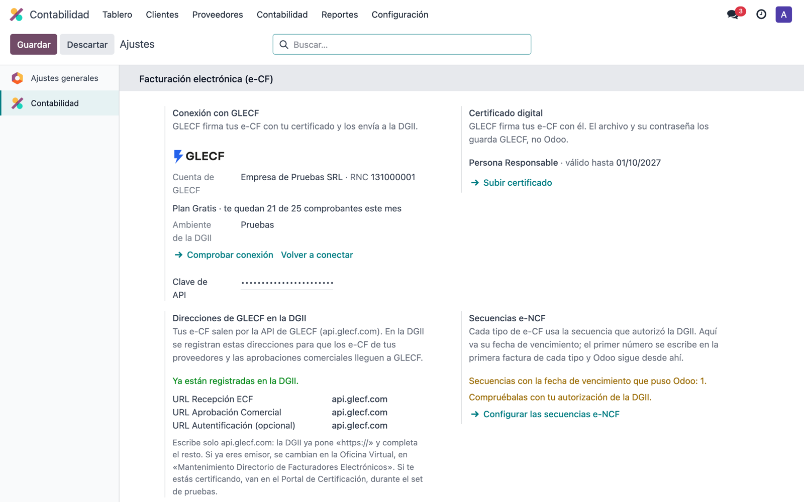
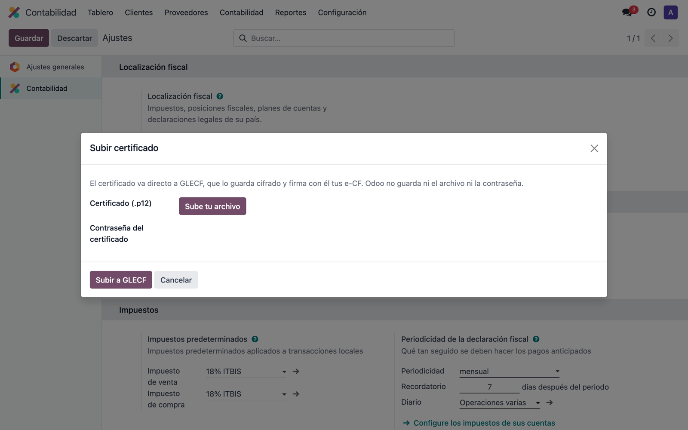
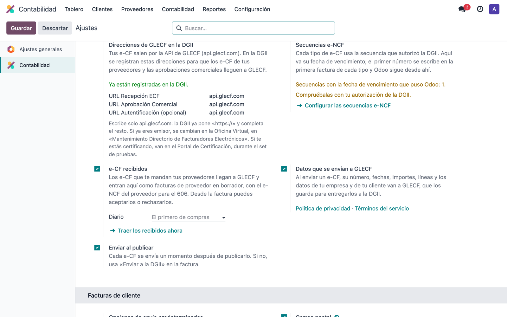
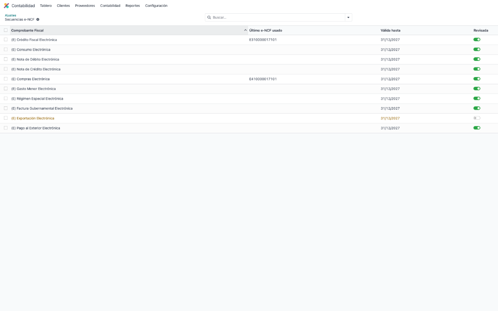
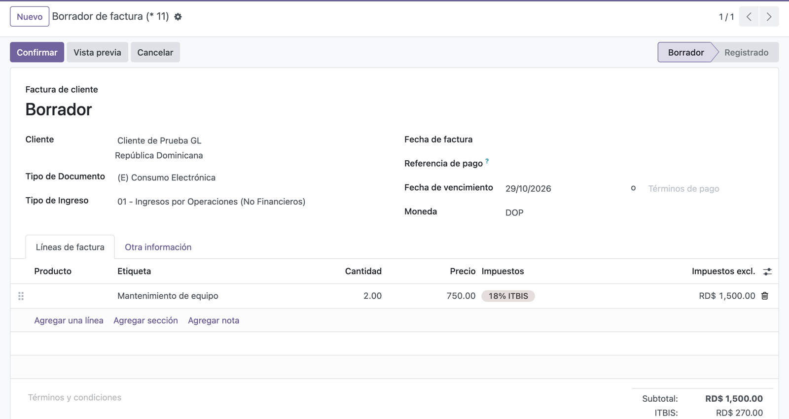
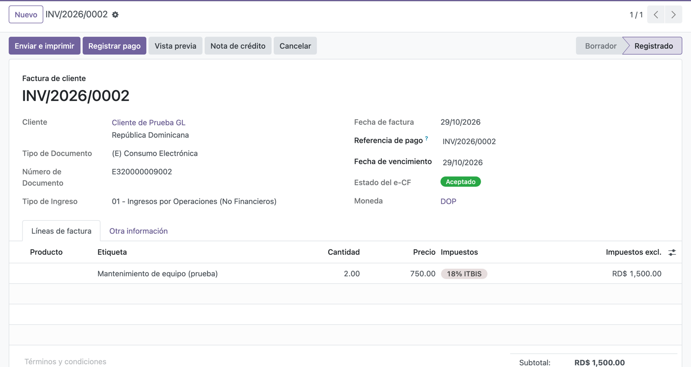
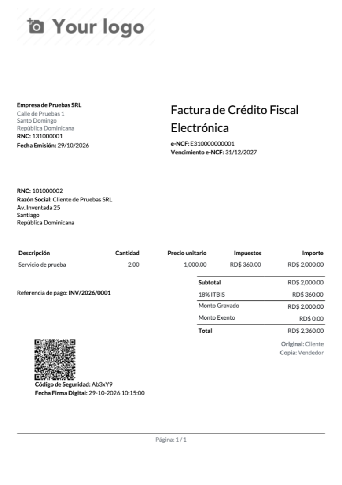
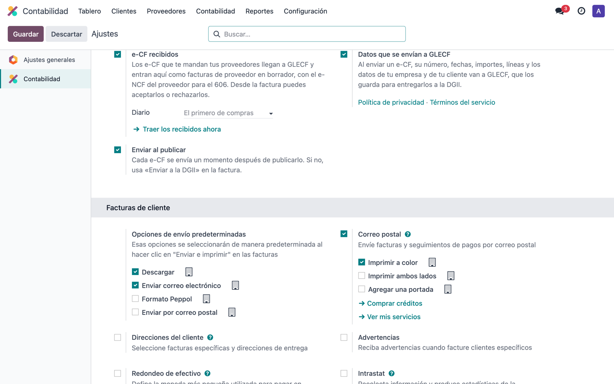
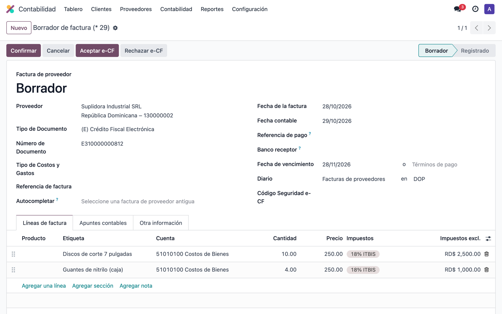
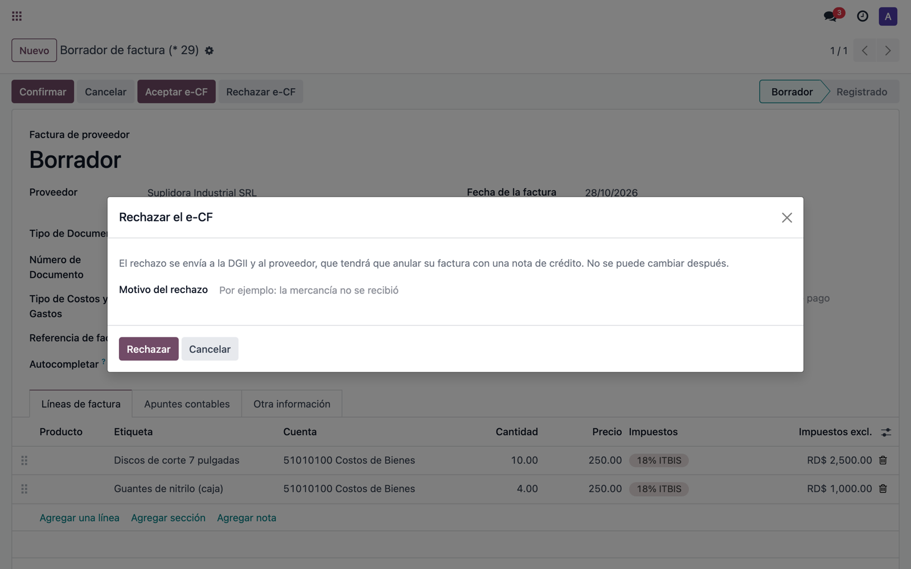

# Manual de e-CF DGII para Odoo

Facturación electrónica para Odoo en República Dominicana: tus facturas salen a
la DGII como comprobantes fiscales electrónicos (e-CF), según la Ley núm. 32-23
de Facturación Electrónica y el Decreto 587-24. La firma y el envío los hace
[GLECF](https://glecf.com).

> **El módulo está en mejora continua.** Funciona en Odoo 20 Community y
> Enterprise. Las capturas son de una empresa de pruebas.

## Antes de empezar

- Odoo 20. La localización dominicana viene incluida.
- Una cuenta de GLECF con **plan de pago** (Licencia Anual, Plan Pro o plan a
  medida). El Plan Gratis no incluye Odoo:
  [glecf.com/precios](https://glecf.com/precios/).
- El certificado digital de la empresa (.p12). Si ya lo subiste a GLECF, por
  ejemplo al certificarte, no hace falta tenerlo a mano.
- Odoo.sh o servidor propio. Odoo Online no admite módulos externos.
- El módulo instalado: en Odoo.sh, desde la
  [tienda de Odoo](https://apps.odoo.com/apps/modules/20.0/l10n_do_ecf_glecf)
  («Deploy on Odoo.sh»); en un servidor propio, como dice el
  [README](../README.md#instalación).

## 1. Marcar la empresa como emisor electrónico

En *Ajustes → Usuarios y empresas → Empresas*, abre tu empresa y marca
**Es Emisor Electrónico**, debajo del RNC. Sin esa casilla, Odoo ofrece los
comprobantes de talonario (B01, B02…) y no los electrónicos (E31, E32…).

## 2. Conectar con GLECF

En *Ajustes → Facturación → Facturación electrónica (e-CF)* (en Enterprise,
*Ajustes → Contabilidad*), pulsa **Conectar con GLECF** e inicia sesión en
GLECF. Allí eliges el **ambiente** y pulsas **Autorizar**. Vuelves a Odoo
conectado. No hay que copiar ninguna clave.

El ambiente empieza siempre en **Pruebas internas**:

| Ambiente | Cuándo |
|---|---|
| Pruebas internas | Para probar. Nada tiene valor fiscal |
| Certificación DGII | Mientras haces la certificación con la DGII |
| Producción | Cuando la DGII ya te tiene como emisor electrónico. Salen comprobantes fiscales reales |

Si la DGII todavía no te tiene como emisor, o si facturas con el Facturador
Gratuito de la DGII, Producción no está disponible.



Ajustes te dice:

- la cuenta de GLECF y su RNC (tiene que ser el de tu empresa en Odoo);
- tu plan y cuántos comprobantes te quedan este mes;
- el ambiente de la DGII (Pruebas, Certificación o Producción);
- si la DGII ya te tiene como emisor electrónico. Si todavía no, solo puedes
  trabajar en Pruebas y el botón **Empezar la certificación** te lleva a GLECF.
  Si facturas hoy con el Facturador Gratuito de la DGII, Ajustes también lo
  dice: para facturar desde Odoo, la DGII pide certificar el sistema nuevo, y
  mientras tanto sigues con el Facturador Gratuito.

Solo cuentan para el plan los comprobantes de Producción.

¿Aún no tienes cuenta? **Crear una cuenta gratis en GLECF** abre el registro
con los datos de tu empresa ya puestos. Después contrata un plan de pago: el
Plan Gratis no incluye Odoo.

## 3. El certificado

Ajustes enseña el certificado que GLECF tiene de tu empresa, con su
vencimiento. Si ya lo subiste a GLECF, por ejemplo al certificarte, no hay nada
que hacer.

Si dice «Todavía no hay certificado», pulsa **Subir certificado**, elige el
archivo .p12 y escribe su contraseña. Va directo a GLECF, cifrado. Odoo no
guarda ni el archivo ni la contraseña.



## 4. Las direcciones para la DGII

Tus e-CF salen por la API de GLECF. Para que los comprobantes de tus
proveedores lleguen a GLECF, en la DGII se registran estas direcciones. En cada
caja se escribe solo `api.glecf.com`.



Si ya eres emisor, se cambian en la Oficina Virtual, en *Mantenimiento
Directorio de Facturadores Electrónicos*. Si te estás certificando, van en el
Portal de Certificación.

## 5. Las secuencias e-NCF

**Configurar las secuencias e-NCF** abre una lista con todos los tipos. Pon a
cada uno la fecha de vencimiento que autorizó la DGII. En amarillo, las que aún
tienen la fecha que puso Odoo.



El primer número de cada tipo se escribe en su primera factura. Después Odoo
sigue solo.

## 6. Facturar

Antes de la primera factura, marca **Datos que se envían a GLECF** en Ajustes.

1. En *Facturación > Clientes > Facturas*, pulsa **Nuevo** y elige el cliente.
   Odoo propone el tipo: **Crédito Fiscal** si el cliente tiene RNC, **Consumo**
   si no.
2. La primera factura de cada tipo pide el **Número de Documento** (el primer
   e-NCF, por ejemplo E310000000001). Después Odoo sigue solo.
3. Añade las líneas con su **ITBIS** y pulsa **Confirmar**.



En unos segundos sale a la DGII y la respuesta vuelve a la factura. El estado
cambia solo en la pantalla, sin recargar.



| Estado | Qué significa |
|---|---|
| Por enviar | Sale sola en unos segundos. Si **Enviar al publicar** está desactivado en Ajustes, pulsa **Enviar a la DGII** |
| Esperando a la DGII | Enviado; falta la respuesta |
| Aceptado | Listo |
| Aceptado con observaciones | Válido; lee el mensaje |
| Rechazado | Si sale **Corregir la factura**, púlsalo, corrige y confírmala otra vez: va con el mismo e-NCF. Si no, el número ya se usó: cancélala y créala de nuevo |
| No enviado | Falta un dato: el mensaje dice cuál. Si es de la factura, pulsa **Corregir la factura**, corrígela y confírmala otra vez. Si es de Ajustes, arréglalo y pulsa **Enviar a la DGII** |
| Requiere revisión | Lee el mensaje. Si sale **Reintentar envío**, no llegó a la DGII: arregla lo que dice y púlsalo. Si no, escribe a soporte@glecf.com |

Si la DGII dice que el certificado **no está delegado**, el administrador de
e-CF de la empresa tiene que darle el rol de Firmante a la persona del
certificado, en la Oficina Virtual (Delegación de e-CF > Delegación de Roles).

**Notas de crédito.** Desde la factura, pulsa **Nota de crédito**, escribe el
motivo y elige el **Código Modificación e-CF**. Si eliges *Porcentaje* o
*Importe*, Odoo crea una línea **sin ITBIS**: un aviso lo dice, y el botón
**Añadir el ITBIS de la factura original** lo pone antes de confirmar.

**En el ambiente de Pruebas** la DGII da a todas las secuencias el vencimiento
31-12-2028; el módulo lo pone solo.

Los diez tipos: E31, E32, E33, E34, E44, E45 y E46 desde las facturas de
cliente; E41, E43 y E47 desde las facturas de proveedor.

**Cada tipo, desde un solo programa.** Si también facturas en GLECF, emite cada
tipo de comprobante desde un solo sitio: las E32 desde Odoo o desde GLECF, no
desde los dos. Cada programa lleva su propia cuenta de números, y tarde o
temprano los dos usan el mismo: GLECF no deja pasar el segundo («El e-NCF … ya
se usó en otro comprobante») y esa factura no sale.

## 7. Pasar a Producción

Cuando la DGII ya te tiene como emisor, en Ajustes, debajo del ambiente, sale
**Cambiar a Producción**: vuelves a GLECF, eliges «Producción» y pulsas
**Autorizar**. Antes, si hiciste facturas de prueba en este mismo Odoo:

1. **Que ninguna quede «Por enviar».** Al pasar a Producción, saldría a la DGII
   como comprobante real. Envíala antes, todavía en Pruebas, o cancélala.
2. **La numeración sigue después de las pruebas.** Cada tipo continúa desde su
   última factura, también si era de prueba: si llegaste a la E310000000005 en
   Pruebas, la primera de Producción será la E310000000006. Los números 1 a 5
   de tu secuencia de Producción quedan sin usar. Se pueden anular en la
   Oficina Virtual de la DGII («anulación de secuencias»): decídelo con tu
   contador.
3. **Las fechas de vencimiento.** En Pruebas, el módulo usa la fecha de la DGII
   para pruebas (31-12-2028). En Producción vale la que pusiste en
   **Configurar las secuencias e-NCF**: revisa que sea la que te autorizó la
   DGII.

Para empezar Producción con la numeración limpia, haz las pruebas en una copia
de tu Odoo (en Odoo.sh, una rama de pruebas; en un servidor propio, una base
duplicada) y conecta a Producción el Odoo de verdad, sin facturas de prueba.

## 8. La factura impresa

Lleva el código QR de consulta de la DGII, el código de seguridad y la fecha y
hora de la firma, como pide la DGII.



**Si el PDF sale sin QR, sin logo o sin diseño**, Odoo no llega a su propia
dirección al generarlo. Pasa sobre todo con Docker o detrás de un proxy. Activa el
modo de desarrollador, ve a Ajustes > Técnico > Parámetros del sistema y crea
`report.url` con `http://localhost:8069`. Si tu Odoo usa otro puerto, pon ese.

Si tu plantilla de factura está personalizada, el módulo se instala igual y omite
los ajustes que no puede aplicar. Ajustes te avisa de cuáles son: revisa lo impreso,
sobre todo el vencimiento del e-NCF.

## 9. Los e-CF que recibes

Los comprobantes que te mandan tus proveedores llegan a GLECF y entran en Odoo
como **facturas de proveedor en borrador**, con el e-NCF del proveedor listo
para el 606 y el XML adjunto. Las notas de crédito y débito se enlazan a su
factura.





En la factura:

1. Elige el **Tipo de Costos y Gastos** (lo pide el 606).
2. Pulsa **Aceptar e-CF**, o **Rechazar e-CF** con el motivo.
3. La respuesta va a la DGII y al proveedor. No se puede cambiar después.



Un e-CF rechazado no se puede publicar. La aprobación es opcional: si no la
envías, la DGII lo da por aceptado cuando lo declaras en el 606.

## Actualizar el módulo

Tu copia del módulo no se actualiza sola. Cuando hay una versión nueva, en Ajustes
> Facturación aparece el aviso «Hay una versión nueva del módulo». Para actualizar,
quien administra tu servidor:

1. Descarga la versión nueva, con `git pull` en la carpeta del módulo.
2. Reinicia Odoo.
3. En Aplicaciones, busca «e-CF DGII para Odoo» y pulsa **Actualizar**.

Tus facturas y ajustes se conservan.

Si `git pull` contesta «Need to specify how to reconcile divergent branches»
(puede pasar si descargaste el módulo el 24 o el 25 de noviembre de 2026), tu
copia no tiene ningún problema: descarga la versión publicada con estas dos
órdenes, en la carpeta del módulo, y sigue con el paso 2.

```bash
git fetch origin
git reset --hard origin/20.0
```

## Ayuda

Escribe a soporte@glecf.com.
